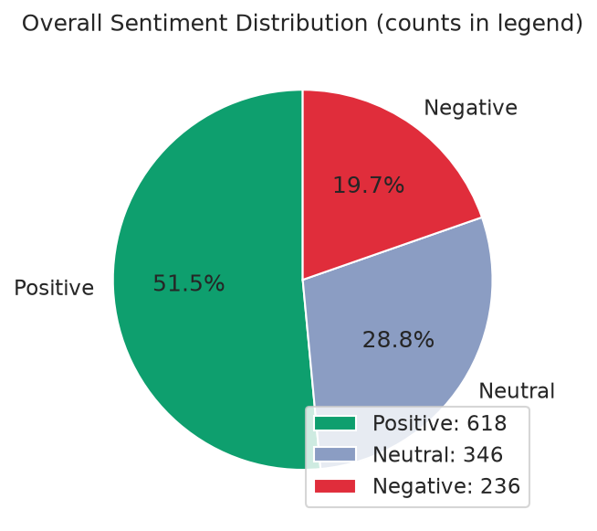
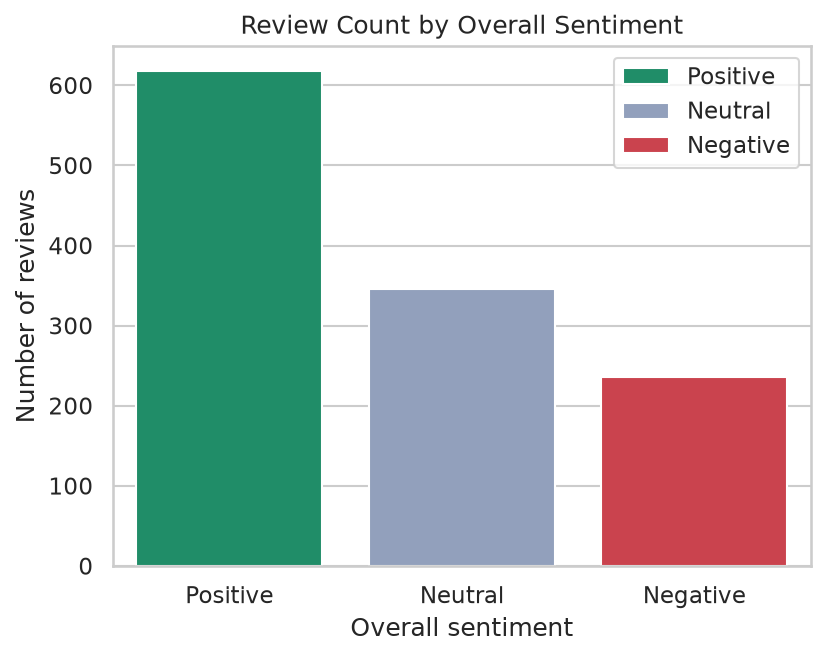
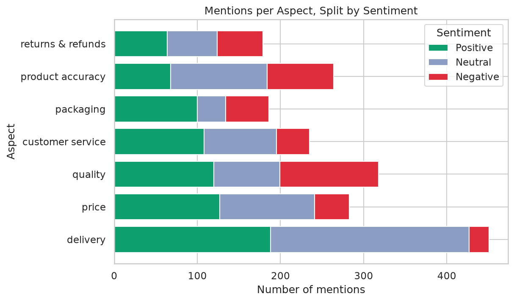

# Data Insights Report — ABSA-Insights
**Dataset:** 1,200 SA e-commerce product reviews (bundled sample dataset, seeded generator — see Data Note in README)
**Method:** Two-stage Aspect-Based Sentiment Analysis (lexicon aspect extraction + VADER clause polarity)
**Author:** Freddy (Tshepiso) Thosago · October 2026 · Week 3, CAPACITI & Clickatell AI Bootcamp

---

## 1. Executive Summary

This analysis ingested 1,200 unstructured e-commerce reviews and, instead of a
single sentiment label, extracted **(aspect, sentiment, evidence) triples**:
1,132 reviews (94.3%) matched at least one of seven tracked aspects, producing
2,016 aspect mentions. Three findings matter most:

1. **Product accuracy is the biggest trust problem.** Of decided
   (positive-or-negative) product-accuracy mentions, **54.1% are negative**
   (80 vs 68). The recurring evidence is "not as described" and colour/size
   mismatch — customers are buying something other than what they saw.
2. **Quality is a coin-flip.** Quality mentions split almost evenly
   (120 positive vs 119 negative). When it is bad, it fails fast: "stopped
   working within a week", "battery is defective".
3. **Delivery is not the pain point it is usually assumed to be.** The
   most-mentioned aspect (451 mentions) is dominated by neutral
   ("delivery took about a week") and positive ("quicker than I expected")
   experiences — only 11.3% of decided delivery mentions are negative.

Overall review sentiment: **618 Positive (51.5%), 346 Neutral (28.8%),
236 Negative (19.7%)**.

## 2. Sentiment Breakdown

| Sentiment | Reviews | Share |
|---|---|---|
| Positive | 618 | 51.5% |
| Neutral | 346 | 28.8% |
| Negative | 236 | 19.7% |

**Plain language:** Just over half of all reviews are positive, and one in
five is negative. For an e-commerce operation, that ~20% negative slice is the
actionable population: the pie tells you how big it is, but only the
aspect-level view (below) tells you *why* — which is the whole point of ABSA.

## 3. Aspect Breakdown — what drives praise and complaints

| Aspect | Mentions | Positive | Neutral | Negative | % negative of decided |
|---|---|---|---|---|---|
| delivery | 451 | 188 | 239 | 24 | 11.3% |
| quality | 318 | 120 | 79 | 119 | 49.8% |
| price | 283 | 127 | 114 | 42 | 24.9% |
| product accuracy | 264 | 68 | 116 | 80 | **54.1%** |
| customer service | 235 | 108 | 87 | 40 | 27.0% |
| packaging | 186 | 100 | 34 | 52 | 34.2% |
| returns & refunds | 179 | 64 | 60 | 55 | **46.2%** |

**Praise drivers:** delivery speed, value-for-money and responsive support
("customer service replied on WhatsApp within an hour", "excellent value for
money", "delivery was quicker than I expected").

**Complaint drivers:** product accuracy (54.1% negative), quality (49.8%),
returns & refunds (46.2%) — the three overlap in the refund loop: an
inaccurate or defective item is followed by a slow refund.

## 4. Root Cause Analysis

**Theme 1 — "Not what I ordered" (product accuracy + quality).**
Recurring evidence: "the colour looks nothing like the picture", "not as
described, the size is completely wrong", "the battery is defective", "it
stopped working within a week". Root cause: catalog/photography gaps and weak
inbound QC are generating both the trust complaints and the returns volume.

**Theme 2 — The silent-support loop (customer service + refunds).**
Recurring evidence: "customer service never replied to my emails", "support
was useless, no response at all", "still no refund three weeks later". Root
cause: support is not failing badly on average (27.0% negative of decided
mentions) — it fails *specifically* on the refund path, where non-response
converts a product problem into a loyalty problem.

**Theme 3 — Packaging damage on fragile categories.**
Recurring evidence: "packaging was damaged and the box was crushed", "no
bubble wrap, just a flimsy envelope". 34.2% of decided packaging mentions are
negative, concentrated on fragile items.

**Positive counterweight (what to protect):** fast, tracked delivery
("parcel arrived in perfect condition", "the tracking actually worked") and
value pricing — these drive the 51.5% positive overall split and are worth
advertising.

## 5. Strategic Recommendations

1. **Run a catalog-accuracy audit on the top-20 listed items.**
   *Finding:* 54.1% of decided product-accuracy mentions are negative; the
   dominant evidence is colour/size mismatch and "not as described".
   *Action:* re-shoot or correct the affected listings; enforce a
   photo-matches-product checklist before publishing.
   *Expected impact:* fewer "not as described" returns and disputes.
   *Metric to track:* product-accuracy negative mentions per 1,000 reviews
   (baseline: 80/1,200 ≈ 67) — target a 30% reduction within a quarter.

2. **Add pre-dispatch QC for electrical/fragile categories.**
   *Finding:* quality mentions are an even 119 negative vs 120 positive, with
   early-life failure evidence ("stopped working within a week", "battery is
   defective").
   *Action:* a 2-minute functional check (charge, power-on) before packing
   on battery/electrical SKUs.
   *Metric:* "broke/stopped working/defective" mention rate per 1,000
   reviews (baseline: 119 quality negatives per 1,200).

3. **Publish and enforce a refund SLA (5 working days).**
   *Finding:* 46.2% of decided returns/refunds mentions are negative; the
   "three weeks later" refund-delay pattern recurs in the evidence.
   *Action:* automated refund-status notifications; escalate at day 3.
   *Metric:* median refund processing time (survey + review monitoring);
   negative returns&refunds mentions per 1,000 reviews (baseline ≈ 46).

4. **Protect the delivery advantage.**
   *Finding:* delivery is the most-mentioned aspect and only 11.3% of decided
   mentions are negative — a genuine strength.
   *Action:* feature verified delivery-time promises in marketing; keep the
   courier mix that produces "quicker than expected" evidence.
   *Metric:* maintain decided-delivery negative share under 15% monthly.

## 6. Methodology and Limitations

- **Data:** 1,200 synthetic-but-realistic SA e-commerce reviews from the
  seeded generator in `data/generate_sample_dataset.py` (reproducible, seed
  42). Swap in real data — the pipeline is dataset-agnostic. The 100-review
  evaluation set is hand-labeled.
- **Models:** VADER baseline (raw text, ±0.05 thresholds) on clause-local
  context; LLM comparison engine (strict JSON, env-var key) implemented in
  `src/compare_llm.py`.
- **Evaluation (VADER, n=100 labeled reviews):** overall accuracy **0.50**,
  macro-F1 **0.476**; aspect-level pooled accuracy **0.383**, macro-F1
  **0.419** (full table: `reports/evaluation_vader.md`). Lexicon aspect
  detection: precision **0.93**, recall **0.82** against 153 gold mentions.
  **LLM comparison: PENDING** — requires `ABSA_LLM_API_KEY`; run
  `python evaluate.py --model llm` to generate the comparison row.
- **Known failure modes:** VADER lexical gaps (e.g. "delivery was two weeks
  late" scores 0.0; "birthday gift" outweighs "ruined" in "late delivery
  ruined the birthday gift surprise" → scored Positive); sarcasm; aspects
  sharing one clause share its clause score; unseen aspects (mitigated by
  the emerging-aspects pass); dataset bias (the sample's aspect mix is
  generator-driven and should not be treated as market truth).
- **What would improve accuracy:** the LLM comparison engine (run it and add
  the row); lexicon expansion for SA retail slang; clause-splitting on "and"
  for compound complaints; a labeled SA reviews corpus for fine-tuning.
